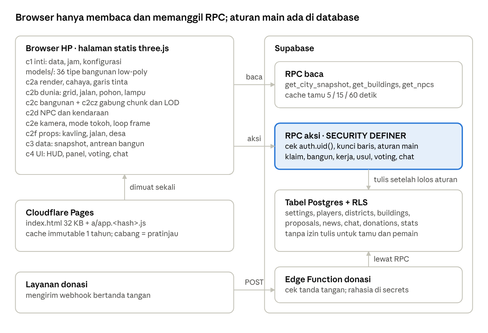

# Republik Netizenia — template kota 3D bersama

Kota 3D di browser yang dibangun pelan-pelan oleh banyak pemain sungguhan. Pemain mengklaim kavling, membangun rumah dengan waktu tunggu nyata, bekerja, dan voting bangunan umum. Game ini berjalan di HP tanpa install, dan biaya server-nya nyaris nol.

*A shared, persistent 3D city-builder for the browser (three.js r128 + Supabase). Indonesian-themed; the engine is reusable for any concept.*



## Isi repo

| Folder / berkas | Isi |
| --- | --- |
| `web/` | kode sumber game: `a_head.html` (gaya), `b_body.html` (UI), `c1…c4` (inti, render, dunia, bangunan, NPC, kamera, props, data, UI), `models/` (36 tipe bangunan) |
| `supabase/schema.sql` | seluruh database: tabel, RLS, RPC `SECURITY DEFINER`, data awal, cache. Idempotent, aman dijalankan ulang |
| `build.js` | menggabungkan `web/` → `dist/index.html` + `dist/a/app.<hash>.js` (di-minify) |
| `config.example.js` | contoh setelan: URL Supabase + publishable key |
| `_headers` | cache 1 tahun untuk `a/*` (Cloudflare Pages) |
| `test/` | uji otomatis Playwright dengan server Supabase tiruan |
| `docs/BLUEPRINT.md` | blueprint lengkap: sistem, arsitektur, UI, design system, keputusan, peran AI dan sub-agen |
| `docs/spek-gaya.md`, `docs/spek-tata-kota.md` | spesifikasi rinci gaya visual dan tata kota |

## Menjalankan dari nol (± 15 menit)

1. **Buat proyek Supabase** (gratis) di supabase.com.
2. **Pasang database:** buka *SQL Editor*, tempel isi `supabase/schema.sql`, lalu jalankan. Baris terakhir harus `OK | v2 terpasang: grid v3 …`. Opsional: aktifkan ekstensi `pg_cron` agar jadwal (gaji, statistik, voting) berjalan otomatis.
3. **Atur login:** di *Authentication → Providers*, aktifkan Email. Game memakai email palsu `nama@<mailDomain>`, jadi matikan *Confirm email*.
4. **Isi setelan:** salin `config.example.js` menjadi `config.js`, lalu isi `url` dan `key` dari *Project Settings → API* (pakai **publishable key**, jangan pernah service_role).
5. **Build dan coba:**
   ```bash
   npm install
   npm run build
   npm run serve      # buka http://localhost:8080
   ```
6. **Publikasikan:** unggah folder `dist/` ke hosting statis apa pun. Untuk Cloudflare Pages: *build command* `npm run build`, *output directory* `dist`, lalu isi variabel lingkungan `NZ_SUPABASE_URL` dan `NZ_SUPABASE_KEY` (publishable key). `build.js` membuat `config.js` dari keduanya.

## Uji otomatis

```bash
npx playwright install chromium
npm test           # build + alur pemain + tata letak kontrol HP (iPhone SE, iPhone 13, Pixel 7)
```

Hasil gambar tersimpan di `test/out/`.

## Mengganti konsep

Mesinnya tetap, kulitnya diganti. Lihat bagian *Cara mengganti konsep* dan *Yang harus dipilih pemilik proyek* di [docs/BLUEPRINT.md](docs/BLUEPRINT.md). Yang biasanya diganti:

- **Nama, palet, dan font:** token CSS di `web/a_head.html`.
- **Bangunan:** `web/models/*.js` + katalog di `supabase/schema.sql`.
- **Props dunia:** `web/c2f_*.js`.
- **Teks UI:** `web/b_body.html` dan `web/c4_ui.js`.

## Keamanan

- Browser hanya memegang URL Supabase + publishable key. Semua aturan main ditegakkan di database lewat RPC `SECURITY DEFINER`, dan tabel tidak bisa ditulis langsung.
- Jangan pernah meng-commit service_role key, password database, atau token webhook. `config.js` sudah masuk `.gitignore`.

## Lisensi

MIT — lihat [LICENSE](LICENSE). Pustaka pihak ketiga: three.js (MIT) dan supabase-js (MIT), dimuat dari CDN. Font Fredoka dan Nunito (SIL OFL) dimuat dari Google Fonts.
