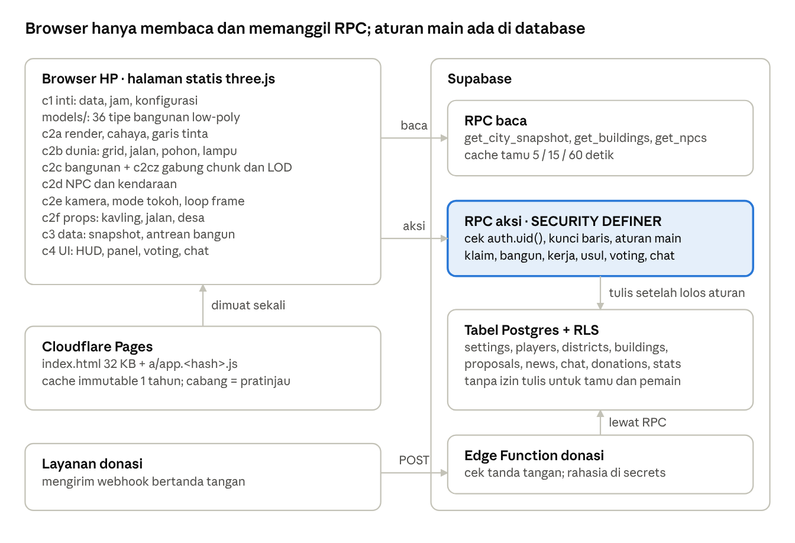
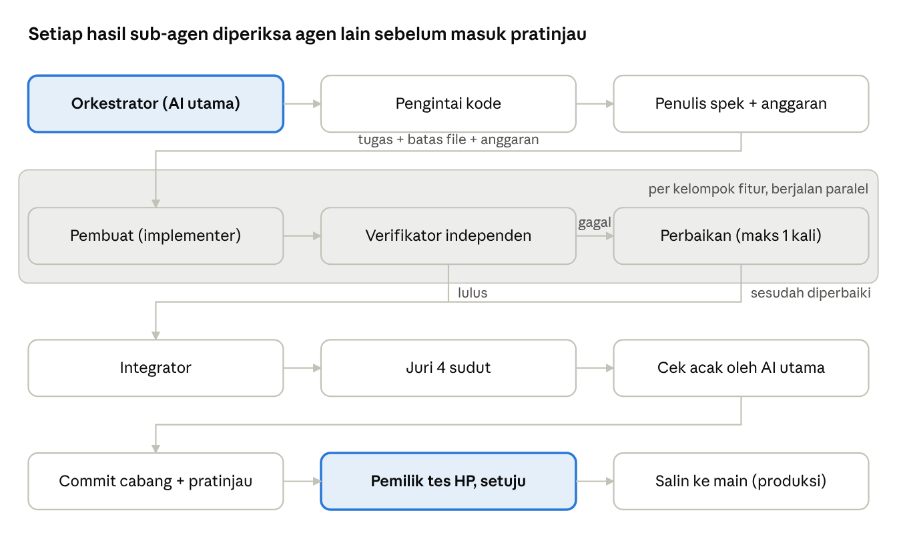

# Blueprint Game Kota Netizen

Versi 11 November 2026

## Ringkasan

Blueprint ini memecah Republik Netizenia v2 menjadi pola yang bisa dipakai ulang: **satu dunia bersama yang dibangun pelan-pelan oleh banyak pemain sungguhan**, berjalan di browser HP tanpa install, dengan biaya server nyaris nol. Tema kota Indonesia hanyalah "kulit". Mesinnya bisa dipakai untuk konsep lain, misalnya koloni Mars, kerajaan fantasi, atau kampus.

Yang tetap sama di setiap konsep (inti):

- **Dunia bersama dan persisten.** Semua pemain melihat peta yang sama, dan perubahan tersimpan di database.
- **Lahan terbatas.** Pemain mengklaim petak, lalu membangun di atasnya dengan waktu tunggu nyata (jam).
- **Ekonomi sederhana.** Ada koin pemain, kas negara, pajak, dan batas harian.
- **Keputusan bersama.** Proyek besar diusulkan lalu divoting, dengan ambang suara dan batas waktu.
- **Dunia hidup.** NPC berjalan, kendaraan, siang-malam mengikuti jam nyata, dan props di jalan.
- **Mode tokoh.** Pemain berjalan di dalam dunia dengan avatarnya, bisa emote dan chat.

Yang diganti per konsep (kulit): nama dan tema, jenis petak dan zona, daftar bangunan dan model 3D-nya, profesi, mata uang, palet warna, serta props.

Untuk siapa: developer web yang paham JavaScript dan SQL dasar. Angka di dokumen ini diambil dari versi yang sedang jalan per tanggal di atas.

## Loop permainan dan sistem inti

Loop harian yang membuat pemain kembali: **klaim → bangun → tunggu → kerja/hasilkan koin → usul/voting → kota tumbuh → pamer ke teman**. Waktu tunggu nyata (jam, bukan detik) adalah alasan pemain membuka game lagi besok.

1. **Masuk sebagai tamu.** Tamu bisa melihat kota, NPC, dan berita tanpa login. Tamu hanya bisa membaca.
2. **Daftar dan pilih profesi.** Contohnya Pedagang. Profesi menentukan gaya bermain dan sumber koin.
3. **Klaim kavling kosong.** Kavling ada di zona yang distriknya sudah dibuka.
4. **Bangun.** Bangunan melewati tahap sketsa, proyek (crane dan pekerja), lalu jadi. Ada jam bangun nyata dan opsi percepatan.
5. **Kerja.** Pemain bekerja di bangunan milik orang lain atau negara dan mendapat koin. Pemilik mendapat pekerja.
6. **Usulan dan voting.** Bangunan publik besar (istana, rumah sakit) diusulkan, lalu warga voting dengan ambang minimal suara setuju dan batas waktu.
7. **Kota tumbuh.** Statistik naik (penduduk, bangunan, cakupan layanan, kepuasan). Distrik baru dibuka dari kas negara.

| Sistem | Isi | Contoh angka di versi sekarang |
| --- | --- | --- |
| Pemain | profil, profesi, koin, peran (warga, presiden) | 303 pemain |
| Penduduk | NPC dan warga yang dihitung dari rumah | 2.634 penduduk, 1.201 NPC |
| Lahan | grid petak, kavling, zona, distrik | 25 distrik (5 × 5), 15.006 kavling kosong |
| Bangunan | tipe, ukuran w×h, tahap, jam bangun, pemilik | 2.796 bangunan, 970 sedang dibangun, 36 tipe model |
| Ekonomi | koin pemain, kas negara, pajak, batas harian | pajak 10, batas harian 300 |
| Pemerintahan | usulan, voting, ambang setuju, durasi voting | minimal 5 setuju, voting 24 jam |
| Cakupan layanan | rumah sakit, sekolah, polisi, taman, lapangan kerja | dipakai untuk skor kepuasan (78 %) |
| Sosial | chat kota, berita otomatis, pengumuman | berita "X mulai bekerja di Y" |
| Donasi | tautan donasi luar, target, daftar donatur | target 100.000 |
| Mode tokoh | avatar, joystick, lompat, lari, emote, chat bubble | 4 emote |
| Waktu | siang-malam mengikuti jam WIB nyata | lampu jendela menyala malam hari |

## Arsitektur teknis

Game ini **tanpa server aplikasi sendiri**: satu halaman statis di CDN berbicara langsung ke Supabase lewat RPC. Biaya tetap rendah, dan keamanan bergantung sepenuhnya pada database.

Alur satu sesi: halaman dan JS dimuat dari CDN, lalu klien memanggil `get_city_snapshot` dan `get_buildings` untuk distrik yang terlihat. Bangunan dibuat bertahap, terdekat dulu. Aksi pemain memanggil RPC aksi, lalu klien memperbarui tampilan dari hasilnya. Snapshot dimuat ulang berkala, dan distrik baru dimuat saat kamera bergeser. Kode sumber dipecah per modul (c1…c4 + `models/`), lalu skrip build menggabungkan dan meng-minify-nya menjadi satu file ber-hash.

## Model data dan RPC

Aturannya satu: **browser tidak pernah menulis tabel langsung.** Semua tabel memakai RLS tanpa izin untuk publik. Setiap aksi pemain lewat fungsi Postgres `SECURITY DEFINER` yang memeriksa aturan main lalu menulis.

Tabel inti (nama boleh diganti per konsep):

| Tabel | Isi | Catatan |
| --- | --- | --- |
| `settings` | satu baris: versi grid, pajak, batas harian, ambang voting, durasi voting, target donasi | dibaca semua RPC |
| `players` | id auth, nama, profesi, koin, peran, warna | koin hanya diubah oleh RPC |
| `districts` | kunci (`k00`…`k24`), nama, ring, biaya buka, status buka, waktu buka | ring 0 pusat, 1 kampung, 2 desa |
| `buildings` | tipe, posisi i/j, ukuran w/h, distrik, pemilik, tahap, jam bangun, percepatan, dilindungi | indeks per distrik |
| `proposals` | bangunan usulan, pengusul, setuju/tolak, diskon, batas waktu, status | satu suara per pemain |
| `jobs` / kerja | siapa bekerja di mana | memberi koin dan berita |
| `news`, `chat`, `announcements` | log kota | dipotong ke N terbaru di snapshot |
| `donations` | nama, jumlah, pesan | diisi dari webhook donasi |
| `stats` | hitungan berkala: penduduk, bangunan, cakupan, kepuasan | dihitung terjadwal, bukan per request |
| `rpc_cache` | hasil RPC baca untuk tamu + waktu | RLS aktif, tanpa grant |

RPC baca, dipanggil tamu dan pemain:

| RPC | Isi | Cache untuk tamu |
| --- | --- | --- |
| `get_city_snapshot()` | kas, pajak, distrik, statistik, berita, chat, usulan, donasi, pengumuman, jam server | 5 detik |
| `get_buildings(p_district)` | bangunan satu distrik | 15 detik per distrik |
| `get_npcs()` | daftar NPC | 60 detik untuk semua |

RPC aksi, khusus pemain login (nama di bawah contoh pola, sesuaikan): daftar profil, klaim kavling, mulai bangun, percepat, kerja, usulkan, voting, chat, buka distrik (presiden/kas). Setiap RPC aksi melakukan hal ini:

1. Ambil `auth.uid()`. Tolak bila kosong.
2. Kunci baris yang disentuh (`for update`) supaya dua pemain tidak mengklaim petak yang sama.
3. Periksa aturan: petak kosong dan di distrik terbuka, koin cukup, belum melewati batas harian, belum voting.
4. Tulis perubahan, tambah berita, lalu kembalikan hasil kecil untuk dipakai klien.

Pemain login selalu mendapat data segar. Cache hanya untuk tamu, karena tamu adalah lalu lintas terbesar. Seluruh SQL ditulis dalam **satu file idempotent** (`create or replace`, `if not exists`), jadi aman dijalankan ulang di SQL Editor.

## Dunia 3D

Dunia adalah **grid petak deterministik**: jalan, kavling, sungai, dan sawah dihitung dari rumus, bukan disimpan di database. Server hanya menyimpan bangunan dan status distrik. Klien bisa menggambar seluruh peta dari satu angka versi grid.

**Tata letak**

- Peta 5 × 5 distrik. Ring 0 di tengah (pusat kota), ring 1 di sekelilingnya (kampung), ring 2 di luar (desa dan sawah).
- Tiap distrik punya pola jalan bertingkat: arteri (jalan protokol dengan median), kolektor, dan gang. Kavling selalu menghadap jalan, sehingga bangunan tidak pernah berdiri di jalan.
- Zona per blok (CBD, ruko, kampung, kota, desa) menentukan bangunan apa yang boleh dan seberapa padat.
- Kavling 1 × 1 untuk rumah. Bangunan besar memakai w × h petak.

**Bangunan**

- Satu file model per tipe (`models/<tipe>.js`), dibangun dari primitif low-poly: kotak, silinder, atap limas, jendela, pagar. Ada 36 tipe di versi sekarang.
- Model menerima ukuran, zona, sisi tetangga, dan *seed*, sehingga dua rumah bertipe sama tetap berbeda (warna, atap, teras).
- Ada anggaran segitiga per model (misalnya rumah sekitar 1.700–2.250 segitiga dekat) dan versi jauh yang lebih ringan.
- Tahap proyek punya model sendiri (pondasi, crane, pekerja), jadi kota terlihat sedang membangun.

**Gaya visual "tinta hangat"**

- Material Lambert datar dengan palet hangat, ditambah garis tinta (outline) pada tepi bangunan.
- Satu matahari dengan bayangan. Langit dan cahaya mengikuti jam WIB nyata; `?jam=20` untuk pratinjau malam.
- Kabut jarak dan bukit di tepi peta menutup batas dunia.
- Target terukur saat menyetel cahaya: kecerahan rata-rata siang V 0,58–0,64, malam 0,30–0,40, dan piksel nyaris putih ≤ 0,4 %.

**Dunia hidup**

- NPC berjalan di trotoar. Mobil, angkot, dan ojek melaju di lajur.
- Props di-*instance* hanya dalam radius kamera: rumput dan papan "dijual" di kavling kosong, gerobak, motor, galon, tong di trotoar, bambu, bebek, dan kerbau di desa.
- Pohon dan lampu jalan diisi ulang hanya ketika titik tatap kamera pindah sel 48 unit, tidak setiap frame.
- Label di atas bangunan menampilkan nama dan progres bangun.

## Performa di HP

Mayoritas pemain memakai HP, jadi **ukur selalu dengan HP lambat**: viewport 390 px dan CPU diperlambat 4×. Dengan cara itu, jeda terlama saat memuat turun dari 6,0 detik ke sekitar 1,2–3,2 detik.

| Teknik | Cara | Dampak |
| --- | --- | --- |
| JS terpisah dan di-minify | `index.html` 32 KB + `a/app.<hash>.js` sekitar 445 KB (153 KB gzip), cache immutable 1 tahun | dari 806 KB halaman inline; kunjungan kedua nyaris tanpa unduhan |
| Gabung bangunan per chunk | bangunan jadi dalam blok 8 × 8 petak digabung jadi satu mesh; pilih bangunan lewat kotak proxy | draw call 693 → sekitar 100 |
| LOD | detail utama/sedang/jauh lewat drawRange; garis tinta hanya dekat (80 u di HP, 120 u desktop) | segitiga terkendali saat kamera jauh |
| Antrean bangun bertahap | bangunan dari server dibuat terdekat dulu, jatah 8 ms per frame di HP (12 ms desktop) | tidak beku saat distrik dimuat |
| Instancing props | satu InstancedMesh per jenis, hanya dalam radius (HP 260 u, desktop 420 u), batas jumlah | +4–6 draw call untuk semua props |
| Tanpa shader baru di tengah main | varian props dipilih lewat matriks, bukan material baru | menghindari beku 2–3 detik saat kompilasi shader |
| Setelan HP | tanpa MSAA, pixel ratio ≤ 1,25, bayangan 1024, chunk > 460 u tidak digambar, NPC 60, mobil 10, pohon tanpa bayangan, sungai tidak dianimasi | frame lebih ringan |
| Mode hemat otomatis | bila FPS < 26 selama 150 frame pertama, kualitas diturunkan dan pemain diberi tahu | HP lemah tetap jalan |
| Cache RPC tamu | snapshot 5 detik, bangunan 15 detik, NPC 60 detik | database tidak kewalahan saat ramai |

Aturan kerja untuk developer:

- Jangan ada kerja berat per frame. Isi ulang dunia hanya saat kunci (sel kamera, distrik terbuka) berubah.
- Setiap fitur visual baru punya anggaran tertulis: draw call, segitiga, program shader, dan jeda terlama di HP. Bandingkan A/B dengan build tanpa fitur itu.
- `?hemat=0` memaksa kualitas penuh untuk pengujian.

## Keamanan dan aturan main

Anggap setiap pemain bisa membuka DevTools dan memanggil API sendiri. Karena itu **semua aturan hidup di database, bukan di JavaScript.**

- **Kunci di klien hanya URL Supabase dan publishable key.** Service role key, password database, dan token webhook tidak pernah masuk repo atau HTML.
- **RLS menyala di semua tabel, tanpa grant tulis untuk `anon`/`authenticated`.** Satu-satunya pintu adalah RPC `SECURITY DEFINER` dengan `search_path` dikunci.
- **Validasi di RPC:** kepemilikan, saldo koin, batas harian, petak kosong, distrik terbuka, satu suara per usulan, panjang chat, dan jeda antar pesan.
- **Bebas balapan:** `select … for update` atau constraint unik pada posisi petak, supaya dua klaim bersamaan tidak sama-sama lolos.
- **Donasi lewat webhook** ke Edge Function yang memeriksa tanda tangan, lalu memanggil RPC. Rahasia webhook hanya disimpan di secrets Supabase.
- **Moderasi:** nama dan chat difilter. Peran presiden atau admin diperiksa di RPC, tidak cukup dengan menyembunyikan tombol.
- **Perubahan database** ditulis ke satu file SQL idempotent, diuji di Postgres lokal (instal bersih dan upgrade dari versi lama), lalu dijalankan pemilik proyek sendiri.
- **Uji izin:** sebagai `anon`, pastikan `select` langsung ke tabel ditolak dan hanya RPC yang menjawab.

## Cara mengganti konsep

Ganti kulitnya, pertahankan mesinnya. Setiap konsep baru cukup mengisi tabel pemetaan di bawah. Kode render, chunk, antrean, cache, dan RPC tetap dipakai.

| Unsur mesin | Netizenia (sekarang) | Koloni Mars | Kerajaan Fantasi | Kampus Hidup |
| --- | --- | --- | --- | --- |
| Dunia | kota Indonesia 5 × 5 distrik | kawah dengan kubah-kubah | lembah dengan benteng di tengah | satu kampus besar dengan fakultas |
| Ring | pusat, kampung, desa | kubah inti, habitat, tambang | ibu kota, desa, hutan liar | rektorat, fakultas, asrama |
| Petak | kavling menghadap jalan | modul di lorong bertekanan | tanah di sepanjang jalan batu | lahan gedung di sepanjang koridor |
| Bangunan | rumah, warung, ruko, rumah sakit, istana | modul hidup, rumah kaca, reaktor | rumah kayu, pandai besi, menara sihir | gedung kuliah, lab, kantin, stadion |
| Profesi | Pedagang dan lainnya | insinyur, petani hidroponik, penambang | ksatria, petani, alkemis | mahasiswa, dosen, UKM |
| Mata uang | koin N, kas negara | kredit oksigen | keping emas | poin SKS |
| Voting | usulan bangunan publik | dewan koloni | sidang kerajaan | BEM |
| Waktu nyata | siang-malam WIB | badai debu | musim | semester dan libur |
| Props hidup | gerobak, motor, sawah, kerbau | rover, drone, panel surya | kereta kuda, ayam, ladang | sepeda, motor parkir, food truck |
| Gaya visual | tinta hangat, palet krem-terakota | oranye-debu, garis tinta dingin | palet buku dongeng | pastel cerah |

Yang harus dipikirkan ulang di setiap konsep:

1. **Kenapa pemain kembali besok?** Waktu bangun nyata, gaji kerja, voting yang berakhir, dan distrik baru.
2. **Kelangkaan.** Lahan dan koin harus terbatas, supaya klaim dan voting terasa berarti.
3. **Identitas.** Nama di atas bangunan, warna pemilik, dan mode tokoh membuat pemain merasa memiliki.
4. **Hal untuk dipamerkan.** Mode foto, kota malam, dan statistik kota yang bisa dibagikan.

Agar tidak menjiplak game lain, desain bangunan, karakter, dan nama dibuat sendiri. Pakai budaya lokal sebagai sumber, seperti yang dilakukan Netizenia dengan warung, angkot, tugu, dan sawah.

## UI dan UX

Prinsipnya: **dunia 3D memenuhi layar, UI hanya menempel di tepi**, dan semua yang sering disentuh berada di jangkauan jempol. Ada tiga mode layar.

**Mode peta (bawaan)**

| Area | Isi | Aturan |
| --- | --- | --- |
| Atas kiri | kartu pemain: inisial, nama, koin, bar kepuasan, peran | ketuk untuk profil; tamu melihat "Masuk / Daftar" |
| Atas kanan | jam WIB + ikon matahari/bulan + "siang/malam" | selalu tampil, membuat dunia terasa nyata |
| Bawah kartu | 3 kapsul statistik (penduduk, kas negara, kepuasan), ticker berita bergulir, donatur terbaru, banner ajakan login | ticker satu baris, tidak menutupi peta |
| Kanan tengah | kolom tombol bundar 44 px: ke rumahku, ke pusat, mode tokoh, mode foto, putar kamera | ikon garis, tanpa teks; teks ada di `aria-label` |
| Bawah tengah | dock kayu 5 menu: Bangun, Kerja, Voting, Kota, Chat | menu aktif naik 3 px dengan latar emas |
| Di atas dunia | label bangunan: nama + bar progres, warna tepi = status (emas milikku, biru voting) | label tidak boleh menumpuk; yang jauh disembunyikan |
| Bawah layar | *sheet* (panel geser dari bawah) untuk detail bangunan, form, daftar | bisa ditarik setengah atau penuh; menutup dock |

**Mode tokoh (jalan-jalan)**

- Joystick mengambang di area kiri-bawah (52 % lebar × 48 % tinggi). Pusatnya pindah ke titik sentuh, dengan zona mati 12 %.
- Tombol dalam busur di sekitar jempol kanan: Lompat 76 px di sudut, lalu Lari, Emote, dan Chat 56 px.
- Emote dibuka sebagai kolom tegak di kanan. Tombol aksi kontekstual ("Lihat Rumah …") ada di kiri, di atas joystick, dengan nama panjang dipotong "…".
- Dock, statistik, ticker, dan tombol samping disembunyikan. Tombol "Selesai" ada di kanan atas.
- Di desktop: WASD, Spasi, Shift, tombol 1–4, dan geser mouse untuk memutar.

**Mode foto:** semua UI hilang, kecuali penggeser jam (0–24) dan tombol Simpan/Selesai.

**Alur utama yang harus mulus (maksimal 3 ketukan):**

1. Tamu membuka link, langsung melihat kota hidup, lalu banner "Masuk untuk ikut membangun".
2. Bangun: Bangun → pilih tipe → kavling yang boleh menyala hijau → ketuk → konfirmasi biaya.
3. Voting: Voting → kartu usulan dengan setuju/tolak dan sisa waktu → ketuk pilihan.
4. Ketuk bangunan mana pun untuk membuka sheet berisi pemilik, tahap, dan tombol aksi.

**Aturan HP (wajib diuji):**

- Target sentuh minimal 44 px, dan tidak ada dua tombol yang bertumpuk di iPhone SE (320 px), iPhone 13, dan Pixel 7.
- Hormati *safe area* (notch, bar navigasi) lewat `env(safe-area-inset-*)`.
- Teks UI minimal 11 px. Angka memakai `tabular-nums` supaya tidak bergoyang.
- Semua umpan balik muncul sebagai toast di atas: hijau berhasil, merah gagal, dengan kalimat manusiawi ("Koin kurang 120").

## Design system

Satu kalimat gaya Netizenia: **kertas krem, kayu cokelat, genteng terakota, daun hijau, aksen emas**, dengan dunia 3D bergaris tinta tipis. Semua nilai disimpan sebagai token CSS di `:root` dan konstanta di kode 3D, supaya konsep baru cukup mengganti token.

**Palet UI (token CSS)**

| Token | Hex | Dipakai untuk |
| --- | --- | --- |
| `--ink` | #2E2117 | teks utama |
| `--muted` | #7A6652 | teks kedua, keterangan |
| `--panel-solid` | #FFF9EC | kartu, sheet, label |
| `--panel2` | #F6EAD2 | latar bagian di dalam panel |
| `--wood` / `--wood2` | #5B3A24 / #7A5234 | dock, toast, tombol mode tokoh |
| `--gold` / `--gold-soft` | #E9A91E / #FFE7B0 | tombol utama, menu aktif, milikku |
| `--green` | #2F7D5B | berhasil, setuju, warna tema browser |
| `--red` | #C8553D | gagal, tolak |
| `--blue` / `--blue-soft` | #3F6E9E / #E2EBF3 | voting, informasi |
| `--cream` | #FFF2D6 | teks di atas kayu |

**Tipografi:** judul dan angka besar memakai **Fredoka** 500–700 (bulat, ramah); teks memakai **Nunito** 600–900. Ukuran: label 3D 11 px/800, isi 14 px/700, judul sheet 18–20 px. Keduanya dari Google Fonts dengan `display=swap`.

**Bentuk dan permukaan**

- Sudut membulat: kartu 18 px, tombol samping 14 px, dock 22 px, sheet 24 px di atas, tombol mode tokoh bulat penuh.
- Bayangan hangat (cokelat, bukan hitam): `0 10px 28px rgba(72,40,12,.22)`.
- Tekstur lokal: pola **kawung** samar di kepala sheet, butiran kertas (*grain*) di latar panel.
- Ikon: SVG garis 24 px, goresan 1,9, ujung membulat, tanpa isi. Emoji hanya untuk emote dan reaksi.
- Tombol utama: gradasi emas #FFD978 → #E9A91E dengan teks gelap #3F2A00.

**Gaya 3D "tinta hangat"** (rincian di spek gaya v2)

- Satu unit = 1 meter. Lantai 3,2 m (lantai dasar usaha 4,2 m), manusia 1,70 m dengan proporsi 1 : 6,5 tanpa wajah, pintu 1,0 × 2,1 m, mobil 4,3 m. Bangunan mengisi 90 % lebar × 92 % dalam kavling dan rapat ke tetangga.
- Garis tinta siluet setebal 1,4 px CSS di mode peta dan 1,8 px di mode tokoh, warnanya warna lokal yang digelapkan (bukan hitam). Garis lipatan interior setebal 1 px perangkat.
- Cahaya: dinding hampir rata (kecerahan 0,85–0,95), bayangan jatuh tegas (0,50–0,60), tanpa vignette.
- Palet 3D: dinding 10 rona pudar (saturasi 0,10–0,35), atap terakota (saturasi 0,55–0,65) atau abu, rumput dua nada (saturasi 0,37–0,44).
- Fasad padat: minimal 25 elemen per muka (jendela berkusen, kanopi, papan nama, AC, talang). Tetangga berbeda warna, jumlah lantai, dan kedalaman muka.
- Kamera peta menunduk sekitar 41°, dengan zoom terikat 30–49°. Kamera tokoh setinggi mata 1,55 m, FOV 62–75°.
- Jalan bertingkat: arteri dengan median, kolektor dengan trotoar 1,4 m, dan gang.

**Cara memeriksa gaya (otomatis, bukan selera):** render 8 sudut tetap pada jam 15 dan jam 20, lalu ukur kecerahan (V) dan saturasi (S) rata-rata. Siang V 0,58–0,64, malam V 0,30–0,40, piksel nyaris putih ≤ 0,4 %. Gambar sebelum/sesudah disimpan berdampingan.

## Yang harus dipilih pemilik proyek

AI bisa mengerjakan hampir semuanya. Keputusan di bawah ini tetap **milik pemilik proyek**, karena menentukan rasa game dan tidak bisa ditebak dari kode. Jawab semuanya sebelum tahap 1. Satu keputusan yang berubah di tengah jalan bisa berarti mengulang beberapa tahap.

| # | Keputusan | Pilihan umum | Pilihan Netizenia | Referensi yang perlu disiapkan |
| --- | --- | --- | --- | --- |
| 1 | Konsep dan tema dunia | kota, koloni, kerajaan, kampus, pulau | kota Indonesia milik netizen | 1 paragraf cerita dunia + 10–20 foto tempat nyata yang jadi sumber rasa (pasar, gang, tugu) |
| 2 | Gaya visual 3D | low-poly datar, tinta/komik, voxel, realistis ringan | low-poly bergaris tinta, cahaya hampir rata | moodboard 10–20 gambar *gaya* (ilustrasi, game sejenis), ditandai apa yang disukai: garis, warna, kepadatan |
| 3 | Palet dan suasana | hangat, dingin, pastel, gelap | krem-kayu-terakota-emas | 5–8 warna kunci, atau foto yang palet warnanya disukai |
| 4 | Gaya UI | kayu/kertas, kaca modern, piksel, minimal | kertas krem + kayu + pola kawung | 3–5 tangkapan layar aplikasi/game yang tombol dan panelnya disukai |
| 5 | Kamera utama | isometrik tetap, 3D bebas, orang ketiga | peta 3D bebas (sudut 41°) + mode tokoh | video pendek atau GIF gerakan kamera yang diinginkan |
| 6 | Ukuran dunia | 1 distrik, 9, 25, tak terbatas | 25 distrik, 15.000+ kavling | target jumlah pemain dalam 3 bulan |
| 7 | Kecepatan waktu | detik, menit, jam nyata | jam nyata (bangun berjam-jam), siang-malam WIB | seberapa sering pemain diharapkan kembali: tiap jam atau tiap hari |
| 8 | Ekonomi | koin saja, koin + kas negara, banyak sumber daya | koin pemain + kas negara + pajak + batas harian | angka awal: koin pemain baru, harga rumah, gaji kerja |
| 9 | Pemerintahan | tanpa voting, voting, pemilu presiden | usulan + voting, peran presiden | aturan voting: ambang, durasi, siapa boleh mengusul |
| 10 | Daftar bangunan | 10, 20, 36 tipe | 36 tipe, dari rumah sampai istana | daftar tipe + 2–3 foto nyata per tipe sebagai sumber bentuk |
| 11 | Login | tamu saja, email, Google | tamu + akun Supabase (Google menyusul) | apakah tamu boleh membangun |
| 12 | Monetisasi | gratis, donasi, item kosmetik | donasi lewat layanan luar | tautan donasi dan target |
| 13 | Bahasa dan nada | formal, santai, gaul | Indonesia santai ("Masuk untuk ikut membangun") | 5 contoh kalimat yang terasa "pas" |
| 14 | Perangkat utama | HP, desktop, keduanya | HP dulu (390 px), desktop menyusul | 1–2 HP kelas bawah untuk tes nyata |
| 15 | Batas performa | longgar, ketat | ketat: jeda terlama di HP tidak boleh naik | HP pengujian + angka target |

**Referensi yang baik vs buruk**

- Baik: "atap genteng merah seperti foto ini", "garis tepi tipis seperti ilustrasi ini", "tombol bulat besar seperti aplikasi ini". Setiap referensi menyebut **apa yang diambil**.
- Buruk: "bikin seperti game X". Referensi dipakai untuk **gaya dan rasa**, bukan untuk disalin. Nama, karakter, model, peta, dan aset game lain tidak boleh dijiplak, sama seperti aturan hak cipta di spek gaya Netizenia.
- Simpan semua referensi dalam satu folder bernomor dengan catatan satu baris per gambar. AI membacanya di setiap tahap desain.

## Peran AI utama

AI utama bekerja sebagai **lead developer dan orkestrator**: memecah pekerjaan, menulis spek, membagi tugas ke sub-agen, memeriksa ulang hasilnya sendiri, lalu merilis lewat jalur pratinjau. Pemilik proyek berperan sebagai **produser**: memberi arah, memilih, menguji di HP, dan menyetujui rilis.

| Pekerjaan | AI utama | Pemilik proyek |
| --- | --- | --- |
| Arah dan konsep | mengusulkan, menuliskan jadi spek | memutuskan (tabel keputusan di atas) |
| Spek teknis dan gaya | menulis spek bernomor dengan angka target terukur | membaca, mengoreksi rasa |
| Kode | menulis, atau membagi ke sub-agen lalu mengintegrasikan | tidak perlu menulis kode |
| Uji | menjalankan alur otomatis, uji HP 390 px dengan CPU 4×, ukur gambar | tes di HP sendiri, melaporkan rasa ("berat", "tombol tabrakan") |
| SQL database | menulis satu file idempotent dan mengujinya di Postgres lokal | menjalankan sendiri di SQL Editor |
| Rilis | push ke cabang → cek pratinjau dengan data asli | menyetujui salinan ke produksi |
| Kunci dan rahasia | tidak pernah meminta, menulis, atau menyimpan | menyimpan di pengaturan Supabase/Cloudflare |

Aturan kerja AI utama:

1. **Tidak menebak keputusan pemilik.** Bila sebuah pilihan mengubah rasa game atau biaya, tanyakan dengan pilihan yang jelas.
2. **Spek dulu, kode kemudian.** Setiap tahap punya spek tertulis dengan angka target (draw call, segitiga, kecerahan, jeda di HP).
3. **Tidak percaya laporan sendiri.** Hasil sub-agen diperiksa ulang oleh agen lain yang tidak melihat proses pembuatnya, lalu dicek acak oleh AI utama.
4. **Perubahan kecil dan bisa dibatalkan.** Setiap file yang diubah punya cadangan. Setiap commit menjelaskan apa dan kenapa.
5. **Tidak menyentuh produksi tanpa izin.** Database dan cabang `main` hanya diubah atas persetujuan eksplisit.
6. **Lapor jujur.** Bila tes gagal atau hasil masih tertutup derau ukur, katakan apa adanya beserta angkanya.

## Sub-agen dan tugasnya

Sub-agen adalah **AI pembantu dengan satu tugas sempit**. Masing-masing hanya tahu yang ditulis di briefing-nya, dan hasilnya selalu diperiksa agen lain. Pola ini dipakai untuk tahap besar Netizenia, misalnya props kavling, jalan, dan desa: 9 agen, semua hasil diverifikasi, dan satu kelompok gagal verifikasi lalu diperbaiki sebelum integrasi.

| Sub-agen | Tugas | Masukan | Keluaran | Selesai bila |
| --- | --- | --- | --- | --- |
| Pengintai kode | membaca kode yang relevan, memetakan fungsi, data, dan titik kait | pertanyaan sempit + folder | peta file dan fungsi, risiko | orkestrator bisa menulis spek tanpa membaca semua file |
| Penulis spek | menulis spek bernomor dengan angka target dan batas | keputusan pemilik, referensi, peta kode | dokumen spek + anggaran (draw call, segitiga, jeda HP) | setiap butir bisa diuji |
| Pembuat (implementer) | menulis kode satu kelompok fitur di file miliknya sendiri | spek, daftar file yang boleh diubah, alat uji | file baru/ubahan + cadangan + ringkasan angka | semua alur uji tanpa error, anggaran terpenuhi |
| Verifikator independen | membangun ulang sendiri dan mencari kesalahan, dengan anggapan hasilnya salah | kode jadi + spek (tanpa catatan pembuat) | lulus/gagal + daftar masalah dengan bukti dan tingkat berat | setiap klaim diuji ulang dengan alatnya sendiri |
| Perbaikan | memperbaiki temuan berat atau sedang, maksimal 1 putaran | temuan verifikator + kode | kode diperbaiki + uji ulang | temuan tertutup dengan bukti |
| Integrator | menyatukan semua kelompok, menyelesaikan bentrok antar fitur | hasil semua kelompok | satu build utuh, uji lengkap, A/B dengan build tanpa fitur | alur uji lolos, anggaran gabungan masuk |
| Juri 4 sudut | menilai dari 4 sudut: logika dunia, tampilan, performa HP, regresi | build akhir | lulus per sudut + bukti angka/gambar | tidak ada sudut yang gagal |
| Pembuat model 3D | membuat atau memoles satu tipe bangunan sesuai tata bahasa fasad | spek tipe, anggaran segitiga, foto referensi | file `models/<tipe>.js` + render 4 sisi | tidak keluar kavling, di dalam anggaran |
| Penulis SQL | menulis perubahan database idempotent, menguji di Postgres lokal | kebutuhan RPC/tabel | bagian file SQL + log uji instal bersih dan upgrade | hasil cache sama dengan hasil segar, `anon` tanpa akses tabel |
| Pengukur performa | mengukur HP (390 px, CPU 4×) beberapa kali bergantian A/B | dua build | tabel jeda terlama, total long task, draw call | selisih di luar derau, atau dinyatakan masih derau |

Aturan briefing sub-agen (ditulis orkestrator):

- **Tujuan satu kalimat** dan definisi selesai yang bisa diuji.
- **Batas file:** daftar file yang boleh diubah. File lain hanya dibaca. Ini mencegah dua agen saling menimpa.
- **Anggaran angka:** contohnya maksimal +6 draw call, segitiga HP ≤ 15 ribu, jeda terlama HP naik ≤ 15 %, tanpa program shader baru.
- **Larangan:** tidak menyentuh git, SQL produksi, atau rahasia, dan tidak mengubah aturan atau data game.
- **Format laporan:** angka sebelum/sesudah, jalur gambar bukti, dan daftar yang belum selesai. Laporan jujur lebih penting daripada laporan "lulus".
- **Verifikator tidak diberi kesimpulan pembuat**, hanya kode dan spek, supaya penilaiannya tidak ikut terarah.

## Langkah membangun dari nol

Bangun berurutan. Setiap tahap harus bisa dimainkan dan diuji di HP sebelum lanjut ke tahap berikutnya.

1. **Fondasi data.** Buat proyek Supabase, lalu satu file SQL idempotent berisi tabel, RLS, `settings`, distrik, dan RPC baca `get_city_snapshot`. Uji sebagai `anon`.
2. **Peta kosong.** Halaman statis dengan three.js versi terkunci: grid deterministik, jalan, kavling, kamera (geser, putar, zoom, sentuh), dan siang-malam.
3. **Akun dan profil.** Login Supabase Auth, RPC daftar, pilih profesi, dan HUD pemain (nama, koin, peran).
4. **Klaim dan bangun.** RPC klaim dan bangun dengan kunci baris, tahap proyek dengan jam nyata, label progres, serta model 3–5 bangunan pertama.
5. **Ekonomi dan kerja.** Koin, kas, pajak, batas harian, kerja di bangunan, dan berita otomatis.
6. **Voting.** Usulan bangunan publik, satu suara per pemain, ambang dan batas waktu, lalu pembangunan otomatis bila lolos.
7. **Dunia hidup.** NPC, kendaraan, props instanced dalam radius, pohon, dan lampu.
8. **Gaya visual.** Palet, garis tinta, cahaya terukur, dan model bangunan lengkap dengan anggaran segitiga.
9. **Performa.** Gabung chunk, LOD, antrean bertahap, setelan HP, mode hemat, JS terpisah dan di-minify, dan cache RPC tamu.
10. **Sosial.** Chat, mode tokoh (joystick mengambang, lompat, lari, emote), mode foto, dan donasi lewat webhook.
11. **Rilis.** Uji di pratinjau dengan data asli, lalu salin ke produksi.

Alat dan versi yang dipakai Netizenia:

| Bagian | Pilihan |
| --- | --- |
| Render | three.js r128 dari CDN, versi dikunci |
| Backend | Supabase (Postgres, Auth, RLS, RPC), supabase-js 2.117.3 |
| Hosting | Cloudflare Pages: cabang kerja menjadi URL pratinjau, `main` menjadi produksi; `_headers` untuk cache immutable `a/*` |
| Build | skrip shell yang menggabungkan modul JS dan model, minify dengan terser, nama file ber-hash |
| Uji | Playwright + Chromium: alur pemain (mock server), HP 390 px dengan CPU 4×, ukur kecerahan gambar, A/B anggaran |

Checklist sebelum rilis:

- [ ] Semua alur uji tanpa error di layar 390 px dan desktop
- [ ] Jeda terlama di HP (CPU 4×) tidak naik dibanding rilis sebelumnya
- [ ] Tidak ada tombol bertumpuk di iPhone SE, iPhone 13, dan Pixel 7
- [ ] SQL baru diuji di Postgres lokal (instal bersih dan upgrade)
- [ ] Tidak ada kunci rahasia di repo atau HTML
- [ ] Pratinjau dicek dengan data asli sebelum disalin ke produksi
